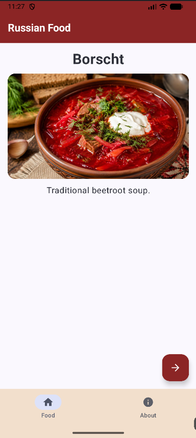
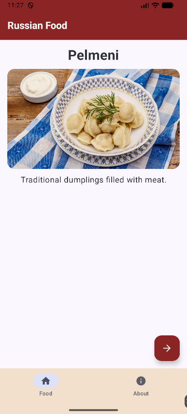
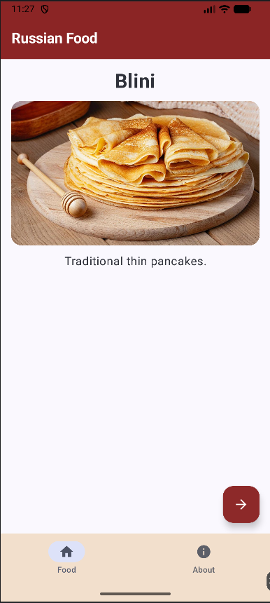
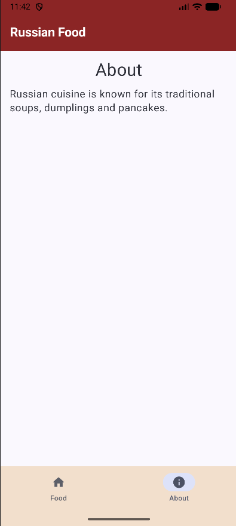

# Russian Food — Android App

A simple educational Android application introducing traditional dishes commonly enjoyed in Russian cuisine.

Developed as part of the **Mobile and Multimedia Device Programming (PMM)** module during Higher Vocational Education in Cross-Platform Application Development (DAM) in Spain.

## Features

- Three traditional dishes: Borscht, Pelmeni and Blini.
- Food images and descriptions in English.
- Bottom navigation with Food and About sections.
- Floating Action Button for switching between dishes.
- UI state management with `rememberSaveable`.

## Screenshots

<table>
  <tr>
    <td align="center">
      <strong>Borscht</strong> 
      
    </td>
    <td align="center">
      <strong>Pelmeni</strong> 
      
    </td>
  </tr>
  <tr>
    <td align="center">
      <strong>Blini</strong> 
      
    </td>
    <td align="center">
      <strong>About</strong> 
      
    </td>
  </tr>
</table>

## Technologies

- Kotlin
- Jetpack Compose
- Material 3
- Gradle Kotlin DSL
- Git and GitHub

## Learning Objectives

- Implementing Scaffold and its main components.
- Using TopAppBar, NavigationBar and FloatingActionButton.
- Managing UI state and recomposition.
- Working with local image resources.
- Practicing Git branches, commits, pull requests and code review.

The project follows the PMM course materials (Blocks 1–4, before Lazy Layouts).

## Getting Started

1. Clone the repository.
2. Open the project in Android Studio.
3. Synchronize Gradle dependencies.
4. Run the application on an Android emulator or physical device.

**Minimum Android version:** Android 7.0 (API 24).
